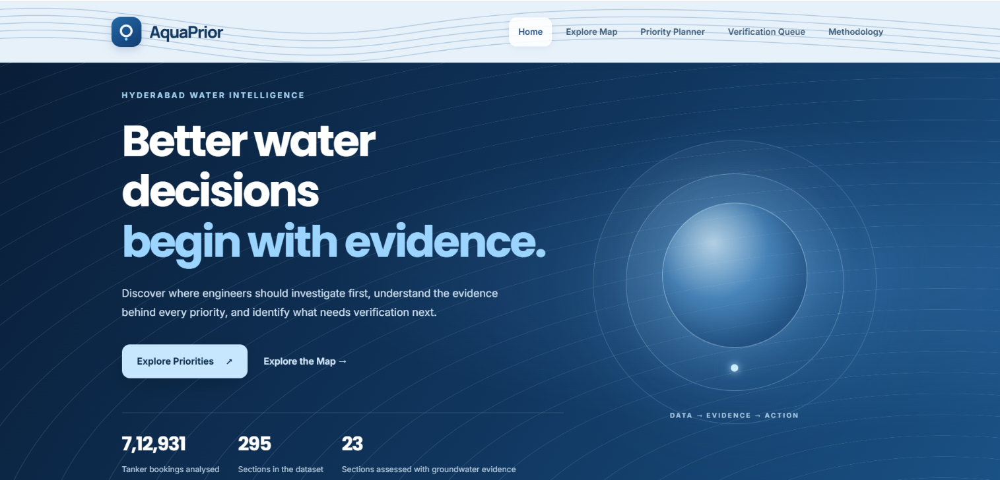
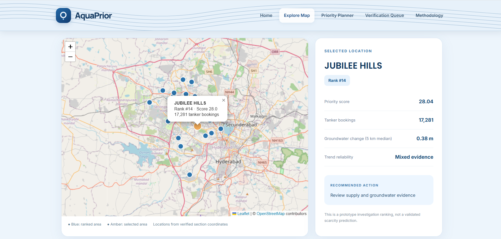
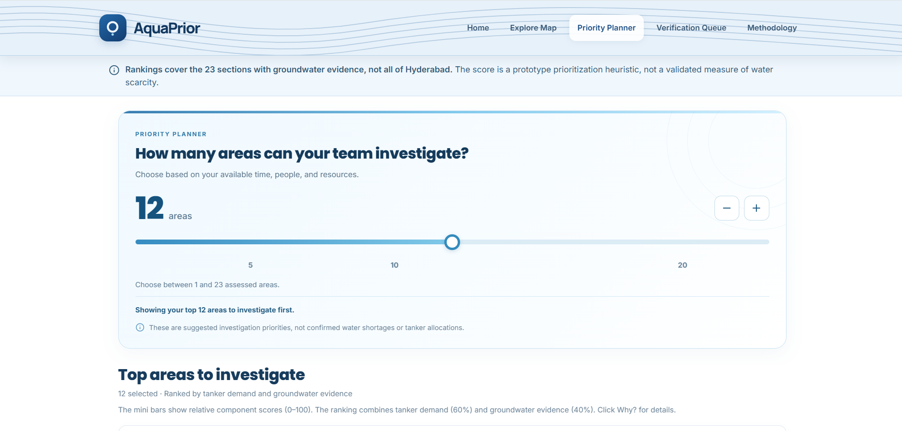
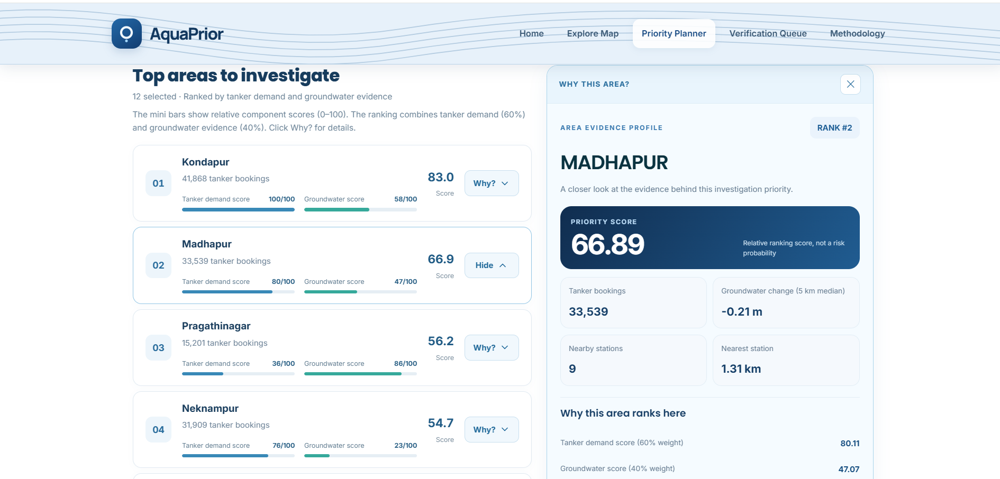
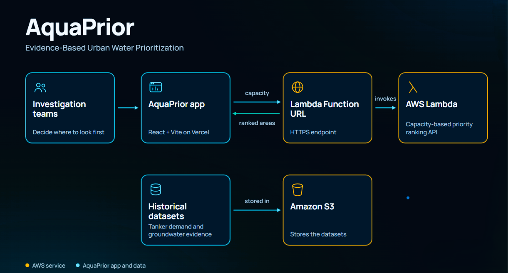
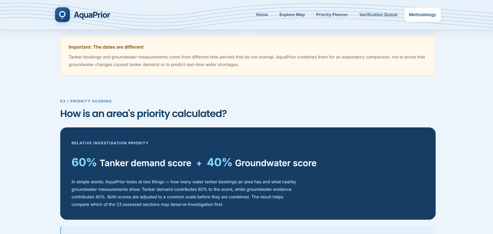

# AquaPrior

**Evidence-based prioritization for urban water investigations.**

Cities can't investigate every neighborhood at once. AquaPrior helps teams decide **where to look first**, shows **why**, and is honest about **where evidence is still missing**.

**[Try the live app →](https://aqua-prior.vercel.app/)**


*Built for the WeMakeDevs **AWS Bharat Builds: Environmental Hacks** hackathon (Ship It track).*

---

## Why I built this

I've seen the water-tanker problem up close. Watching families depend on tanker deliveries made me wonder: when time and resources are limited, how does a team decide which areas deserve attention first?

AquaPrior is my answer. It doesn't claim to know which neighborhood is "in shortage" from a single number. It helps teams **choose where to start, understand the evidence behind that choice, and see what still needs verification.**

## The problem

A city may have hundreds of sections, while an investigation team can examine only a handful. Two signals can help, but each is incomplete:

- **Tanker bookings** show recorded demand, but demand alone doesn't prove scarcity.
- **Groundwater monitoring** adds a physical signal, but coverage and reliability are uneven.

AquaPrior combines both without hiding the uncertainty.

## What it does

| Feature | What you get |
| --- | --- |
| **Priority Planner** | Pick your investigation capacity (1 to 23) and instantly see the top-ranked sections. |
| **Explainable rankings** | Open any area to see booking totals, demand and groundwater components, nearby monitoring context, and reliability notes. |
| **Explore Map** | View the 23 assessed sections on an interactive map and click markers for their evidence. |
| **Verification Queue** | See demand-eligible sections that lack location-linked evidence, kept visible instead of ranked on weak data. |
| **Methodology** | Read the scoring method, assumptions, and limitations in full. |

Works on desktop and mobile; desktop gives the best experience.

## Data at a glance

| Measure | Count |
| --- | ---: |
| Tanker bookings analyzed | **712,931** |
| Sections in source dataset | **295** |
| Demand-eligible sections (100+ bookings) | **218** |
| Assessed with groundwater evidence | **23** |
| Verification Queue | **195** |
| Below demand threshold | **77** |

**Periods covered:** tanker bookings from June to August 2026; groundwater evidence from September 2 to October 2, 2026, with nearby monitoring considered at 3 km and 5 km and reliability indicators attached.

These are historical, limited inputs, not real-time citywide measurements.

## How prioritization works

For the 23 assessed sections, AquaPrior uses a simple, transparent heuristic:

```
Relative priority score = 60% × normalized tanker demand
                        + 40% × normalized groundwater evidence
```

Pick a capacity, and the planner returns that many top-ranked sections. Select an area like **Kondapur or Madhapur** to see exactly what drives its rank: bookings, groundwater change, nearby stations, and score components.

> **A high score is not a shortage probability, a validated scarcity measure, or an instruction to allocate tankers.** The 60/40 weighting is an explicit prototype design choice, not a field-validated optimum.

## Why the Verification Queue matters

Of 218 demand-eligible sections, only 23 have the evidence needed for a ranking. The other 195 stay in the Verification Queue.

**Missing evidence is not missing need.** Rather than forcing every section into a confident-looking leaderboard, AquaPrior separates what can be compared today from what needs a closer look.

## Architecture

| Layer | Technology | Role |
| --- | --- | --- |
| Frontend | React + Vite | Interactive site and planner |
| Map | React Leaflet + OpenStreetMap | Approximate geographic view |
| Hosting | Vercel | Public deployment |
| Backend | AWS Lambda | Returns ranked investigation areas for the requested capacity |
| API | Lambda Function URL | HTTPS link between frontend and backend |
| Storage | Amazon S3 | Project datasets |

**Flow:** the React app on Vercel calls the Lambda Function URL with the selected capacity, and Lambda returns the ranked areas. S3 stores the datasets; it is not part of the request path, and S3 does not trigger Lambda.

## Try it in 60 seconds

1. Open the **[live app](https://aqua-prior.vercel.app/)**.
2. In **Priority Planner**, choose a capacity such as 5 or 10.
3. Click a ranked area or **Why?** to see its evidence.
4. Open **Explore Map** to see where the assessed sections are.
5. Check the **Verification Queue** to see what still needs evidence.
6. Read **Methodology** for the assumptions behind it all.

## Run locally

Requires Node.js and npm.

```bash
cd frontend
npm install
npm run dev
```

Open the address Vite prints. The ranking API is deployed on AWS, so the frontend needs access to its configured endpoint.

To test a production build:

```bash
npm run build
```

## Limitations and responsible use

- AquaPrior is an **investigation-priority prototype**, not a validated water-shortage prediction system.
- Tanker bookings reflect recorded demand, not proof of groundwater depletion or household shortage.
- Groundwater coverage and trend reliability vary by section; some evidence is limited or mixed.
- Map markers are **approximate locations**, not surveyed administrative boundaries.
- Rankings compare only the 23 assessed sections under this heuristic; they don't measure absolute scarcity.
- Field investigation and local verification are still required before any operational decision.

---

**Better water decisions begin with evidence, and with being clear about where that evidence is still missing.**
